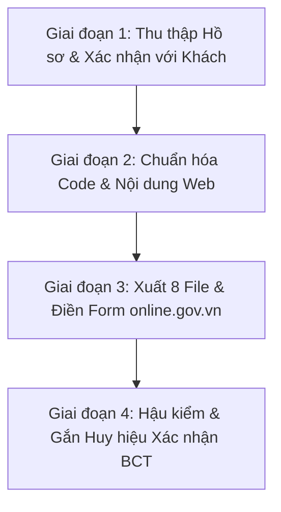

# 🏛️ Quy Trình Thông Báo Website TMĐT Bán Hàng Với Bộ Công Thương (1 Phát Ăn Ngay)

> **Cơ sở pháp lý tối cao:**
> - **Nghị định 52/2013/NĐ-CP** về thương mại điện tử.
> - **Nghị định 85/2021/NĐ-CP** sửa đổi, bổ sung một số điều của Nghị định 52.
> - **Nghị định 13/2023/NĐ-CP** về bảo vệ dữ liệu cá nhân.
> - **Thông tư 47/2014/TT-BCT** & **Thông tư 21/2018/TT-BCT** quy định về quản lý website TMĐT.

---

## 🎯 1. Phân Định Thủ Tục & Loại Hình Website

| Tiêu chí | Thông báo Website TMĐT bán hàng (SOP này) | Đăng ký Sàn giao dịch TMĐT |
| :--- | :--- | :--- |
| **Bản chất** | Website do thương nhân/tổ chức tự lập để bán hàng hóa, dịch vụ của **chính mình** | Cho phép **bên thứ ba (người bán khác)** mở gian hàng, đăng bán |
| **Huy hiệu được cấp** | **ĐÃ THÔNG BÁO BỘ CÔNG THƯƠNG** (Màu **Xanh dương**) | **ĐÃ ĐĂNG KÝ BỘ CÔNG THƯƠNG** (Màu **Đỏ**) |
| **Lệ phí nhà nước** | **0 VNĐ (Hoàn toàn miễn phí)** | **0 VNĐ (Nhưng hồ sơ phức tạp, cần Đề án)** |
| **Thời gian xét duyệt** | **3 – 7 ngày làm việc** | **15 – 30 ngày làm việc** |

---

## 🚨 2. "9 BẪY THỰC CHIẾN" Khiến Hồ Sơ Bị Trả Lại (Phải Diệt Triệt Để)

Chuyên viên Cục TMĐT & KTS sẽ trực tiếp truy cập tên miền, đặt thử hàng test và soi từng trang chính sách đối chiếu với Giấy chứng nhận ĐKKD:

1. **Lệch ngành hàng trong nội dung chính sách:** 
   - *Bẫy:* Copy code/seed mẫu từ dự án cũ (ví dụ: web bán PC nhưng trang bảo hành lại ghi *"bảo hành tủ lạnh, máy giặt, điều hòa ống đồng"*).
   - *Xử lý:* Viết lại 100% nội dung chính sách theo đúng ngành hàng thực tế của website.
2. **Cổng thanh toán trung gian trực tuyến (OnePay, VNPay, Bảo Kim, MoMo, ZaloPay):**
   - *Bẫy:* Để nút thanh toán trực tuyến nhưng chưa có Hợp đồng kết nối chính thức hoặc đang chạy Sandbox test $\rightarrow$ BCT yêu cầu nộp bản scan Hợp đồng thanh toán.
   - *Xử lý:* Nếu chưa có Hợp đồng thật $\rightarrow$ **Tạm ẩn** các nút thanh toán trực tuyến trong 5–7 ngày chờ duyệt (chỉ để COD và Chuyển khoản ngân hàng). Duyệt xong có logo xanh thì bật lại.
3. **Số tài khoản ngân hàng cá nhân:**
   - *Bẫy:* Để STK cá nhân của giám đốc/nhân viên trên trang Chính sách thanh toán $\rightarrow$ BCT từ chối vì không khớp pháp nhân công ty.
   - *Xử lý:* Bắt buộc ghi Số tài khoản đứng tên **Công ty/Tổ chức** (trùng tên trên ĐKKD).
4. **Lệch địa chỉ giữa Footer và Giấy ĐKKD:**
   - *Bẫy:* Đổi địa chỉ theo địa giới hành chính mới (hoặc viết tắt) lệch với bản scan Giấy ĐKKD.
   - *Xử lý:* Khớp chính xác từng từ trên Giấy ĐKKD. Nếu có đổi địa giới hành chính, ghi rõ: `Số... Xã Tân Triều, Huyện Thanh Trì... (Nay là Phường Thanh Liệt, TP. Hà Nội)`.
5. **Số Hotline hoặc Tổng đài ảo:**
   - *Bẫy:* Để số tổng đài mẫu `1900 1234` hoặc số chưa hoạt động.
   - *Xử lý:* Thay toàn bộ bằng số điện thoại di động/bàn thật có người trực.
6. **Thiếu cơ chế Đồng kiểm hàng hóa (Nghị định 85/2021/NĐ-CP):**
   - *Bẫy:* Trang vận chuyển chỉ ghi thời gian giao, không nêu quyền kiểm tra hàng.
   - *Xử lý:* Bắt buộc có điều khoản: Khách hàng được quyền **ĐỒNG KIỂM** (mở gói hàng kiểm tra ngoại quan, model, số lượng) trước khi thanh toán, và quy định trách nhiệm bồi thường của đơn vị vận chuyển đối tác.
7. **Thiếu 7 điều khoản Bảo vệ dữ liệu cá nhân (Nghị định 13/2023/NĐ-CP & Điều 68-73 NĐ 52):**
   - *Bẫy:* Trang bảo mật sơ sài 1-2 đoạn chung chung.
   - *Xử lý:* Phải có đủ 7 mục: Mục đích thu thập, Phạm vi sử dụng, Thời gian lưu trữ, Những người/tổ chức được tiếp cận, Đơn vị thu thập và quản lý, Công cụ chỉnh sửa dữ liệu, Cơ chế tiếp nhận và giải quyết khiếu nại.
8. **Thiếu Checkbox chấp thuận điều khoản tại Giỏ hàng:**
   - *Bẫy:* Khách bấm đặt hàng không có bước xác nhận điều khoản giao dịch.
   - *Xử lý:* Thêm checkbox bắt buộc trước nút Đặt hàng: *"Tôi đã đọc và đồng ý với Điều khoản giao dịch chung và Chính sách bảo mật của website"*.
9. **File PDF đính kèm bị thanh nổi (Floating Bar) đè chữ:**
   - *Bẫy:* Chụp PDF từ web mobile/desktop nhưng thanh bottom-nav hoặc nút Zalo/Hotline lặp lại ở chân mỗi trang đè lên chữ/số tài khoản.
   - *Xử lý:* Dùng script Playwright tự động inject CSS `@media print` ẩn hoàn toàn các phần tử fixed/sticky trước khi render PDF.

---

## 🛠️ 3. Quy Trình 4 Giai Đoạn Triển Khai "1 Phát Ăn Ngay"



### 📋 Giai đoạn 1: Thu thập Hồ sơ & Xác nhận với Khách hàng

Gửi mẫu tin nhắn sau cho đại diện doanh nghiệp/chủ sở hữu website:
```text
Gửi anh/chị [Tên Khách],
Để hoàn tất thủ tục Thông báo Website với Bộ Công Thương (online.gov.vn), anh/chị gửi giúp em các thông tin sau nhé:
1. Bản scan màu (hoặc ảnh chụp phẳng rõ 4 góc) Giấy Đăng ký kinh doanh mới nhất.
2. Thông tin Người đại diện pháp luật: Số CCCD, Ngày cấp, Nơi cấp, Chức vụ, SĐT và Email nhận mã kích hoạt từ Bộ Công Thương.
3. Số tài khoản Ngân hàng đứng tên Công ty (Số TK, Ngân hàng, Chi nhánh) để niêm yết trên web.
4. Xác nhận cổng thanh toán: Nếu chưa ký hợp đồng chính thức với bên trung gian (OnePay/VNPay...), bên em sẽ tạm ẩn các nút này 5-7 ngày để BCT duyệt nhanh 1 lần qua luôn.
```

---

### 💻 Giai đoạn 2: Chuẩn hóa Code & Nội dung Web

1. **Thông tin Chân trang (Footer) — Điều 29 NĐ 52:**
   - Tên đầy đủ của đơn vị chủ quản (đúng trên Giấy ĐKKD).
   - Mã số thuế / Số Giấy chứng nhận ĐKKD, Ngày cấp, Nơi cấp.
   - Tên người đại diện theo pháp luật.
   - Địa chỉ trụ sở chính, Số điện thoại, Email liên hệ.
2. **Bộ 10 Trang Chính sách & Điều khoản bắt buộc:**
   - `/chinh-sach-bao-mat`: 7 điều khoản theo NĐ 52 & NĐ 13/2023.
   - `/chinh-sach-van-chuyen`: Thời gian, biểu phí, chính sách **Đồng kiểm 100%**, phân định trách nhiệm logistics.
   - `/chinh-sach-doi-tra`: Điều kiện đổi mới, thời hạn (ví dụ: 1 đổi 1 trong 30 ngày), quy trình hoàn tiền (1-3 ngày).
   - `/chinh-sach-bao-hanh`: Quy chuẩn, điều kiện, địa điểm tiếp nhận bảo hành.
   - `/chinh-sach-thanh-toan`: Tiền mặt (COD), Chuyển khoản ngân hàng (STK công ty), Hóa đơn VAT.
   - `/dieu-khoan-su-dung`: Quy chế giao dịch, quy trình giao kết hợp đồng, quyền và nghĩa vụ 2 bên.
   - `/gop-y` (hoặc `/khieu-nai`): Form gửi khiếu nại online và quy trình xử lý 4 bước.
   - `/huong-dan-mua-hang`, `/huong-dan-tra-gop`, `/lien-he`.
3. **Giỏ hàng & Đặt hàng:**
   - Bắt buộc có dòng xác nhận hoặc checkbox đồng ý điều khoản trước khi gửi đơn.
   - Ẩn các cổng thanh toán chưa có Hợp đồng thật.
4. **Deploy & Seed dữ liệu lên Production:**
   - Triển khai code và cập nhật Database trên live server trước khi nộp hồ sơ.

---

### 📦 Giai đoạn 3: Xuất 8 File Đính Kèm & Khai Báo Form `online.gov.vn`

#### 1. Chạy script tự động xuất 7 file PDF + 1 Logo:
Sử dụng script đi kèm skill:
```powershell
python "C:\Users\Opengate\.gemini\config\plugins\wb-agent\skills\dang-ky-bo-cong-thuong\scripts\export_bct_files.py" --url "https://domain.com" --brand "slug" --out "./docs/bct-files" --logo "./public/logo.png"
```
Script sẽ tự động:
- Khởi động Headless Chromium, tải các trang chính sách.
- Inject CSS ẩn toàn bộ floating bar, mobile menu, nút Zalo/Hotline nổi.
- Gộp các trang thành **7 file PDF chuẩn** và mở thư mục Windows Explorer.

#### 2. Danh mục 8 file đính kèm:
- `0_Logo_<brand>.png`: Logo website nền trong suốt (< 2MB).
- `1_Chinh_sach_bao_mat_<brand>.pdf`: Trang Chính sách bảo mật.
- `2_Phuong_thuc_tiep_nhan_va_giai_quyet_khieu_nai_<brand>.pdf`: Gộp trang Góp ý + Điều khoản sử dụng.
- `3_Chinh_sach_gia_<brand>.pdf`: Gộp trang Hướng dẫn mua hàng + Quy định giá.
- `4_Chinh_sach_ve_thanh_toan_<brand>.pdf`: Trang Chính sách thanh toán.
- `5_Dieu_kien_cung_cap_hang_hoa_dich_vu_<brand>.pdf`: Trang Điều khoản sử dụng.
- `6_Chinh_sach_giao_hang_doi_tra_hoan_tien_<brand>.pdf`: Gộp Vận chuyển & Đồng kiểm + Đổi trả & Hoàn tiền + Bảo hành.
- `7_Hinh_thuc_ho_tro_truc_tuyen_<brand>.pdf`: Gộp trang Liên hệ + Góp ý.
- File PDF bản scan màu 2 mặt Giấy ĐKKD.

#### 3. Điền 7 đoạn văn bản mô tả chính sách:
Mở file mẫu tại:
`C:\Users\Opengate\.gemini\config\plugins\wb-agent\skills\dang-ky-bo-cong-thuong\templates\bct_form_texts.md`
Copy và dán lần lượt vào 7 ô text trên cổng `online.gov.vn`.

---

### 🎖️ Giai đoạn 4: Hậu Kiểm & Gắn Huy Hiệu BCT Khi Được Duyệt

Sau khi hồ sơ chuyển sang trạng thái **"Đã xác nhận"**:

1. **Lấy liên kết định danh & mã nhúng:**
   - Link tra cứu công khai: `https://online.gov.vn/nen-tang/<UUID-HO-SO>`
2. **Gắn Huy hiệu vào Footer Website:**
   - Tải file ảnh huy hiệu chuẩn BCT xanh dương (`logo-da-thong-bao-bo-cong-thuong.png`).
   - Gắn thẻ `<a>` mở tab mới:
     ```html
     <a href="https://online.gov.vn/nen-tang/<UUID-HO-SO>" target="_blank" rel="noopener noreferrer" title="Đã xác nhận với Bộ Công Thương">
       
     </a>
     ```
3. **Cập nhật Schema Organization (SEO E-E-A-T):**
   - Thêm URL tra cứu BCT vào thuộc tính `sameAs`:
     ```json
     "sameAs": [
       "https://online.gov.vn/nen-tang/<UUID-HO-SO>",
       "https://facebook.com/...",
       "https://zalo.me/..."
     ]
     ```
4. **Bật lại các cổng thanh toán online** (nếu trước đó đã tạm ẩn).
